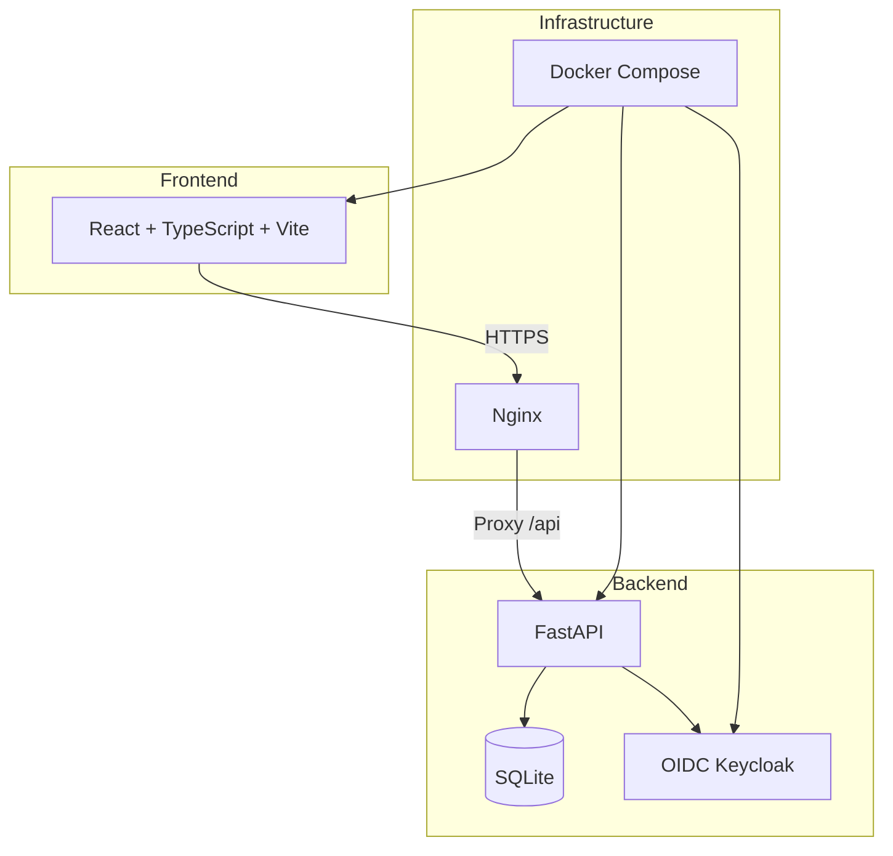

# Axiom Lens — Alan Vo

> Work in progress. This checkpoint may be incomplete or fail tests. See PLAN.md and STATUS.md before use.


> **Axiom Lens** is an AI-assisted reverse engineering analysis platform derived from REA (Reverse Engineer Anything). It provides a web-based interface for analyzing binaries, JavaScript/Electron applications, and process behavior with AI-powered insights.

## Quick Start

### Prerequisites
- Docker and Docker Compose
- Or: Python 3.12+, Node.js 24+, npm

### Using Docker Compose (Recommended)

```bash
# Copy environment template
cp .env.example .env

# Edit .env with your settings (especially SECRET_KEY for production)
# Start all services
docker compose up --build -d

# Access the application
# Frontend: http://localhost
# Backend API: http://localhost:8000
# API Docs: http://localhost:8000/docs
# Keycloak Admin: http://localhost:8080 (admin/admin)
```

### Local Development

**Backend:**
```bash
cd backend
python3 -m venv .venv
source .venv/bin/activate
pip install -r requirements.txt
cp ../.env.example .env
# Edit .env as needed
python -m uvicorn app.main:app --reload --host 127.0.0.1 --port 8000
```

**Frontend:**
```bash
cd frontend
npm install
npm run dev
```

**Run Tests:**
```bash
# Backend tests
cd backend
source .venv/bin/activate
PYTHONPATH=backend python -m pytest tests/ -v

# Frontend tests
cd frontend
npm test
```

## Architecture



## Features

### Authentication
- OIDC Keycloak integration with authorization code flow + PKCE
- Demo mode for development (no Keycloak required)
- HttpOnly SameSite cookies with CSRF protection
- Role-based access control (viewer, operator, admin)

### Analysis Management
- Create, list, view, update, delete analyses
- Three analysis types: Binary, JavaScript/Electron, Process
- Pagination and filtering
- Export results as JSON
- Audit logging for security events

### Analysis Workflows (UI Ready, Engine Integration Planned)
1. **Binary Analysis** - Pseudocode, assembly, strings, symbols, calls, references
2. **JavaScript/Electron Analysis** - Modules, imports, IPC boundaries, native addons
3. **Process Comparison** - Terminal output, filesystem observations, semantic diff

## API Reference

### Health & Version
- `GET /api/v1/health` - Health check
- `GET /api/v1/version` - Version info
- `GET /api/v1/ready` - Kubernetes readiness probe
- `GET /api/v1/live` - Kubernetes liveness probe

### Authentication
- `GET /api/v1/auth/login` - Initiate OIDC login
- `GET /api/v1/auth/callback` - OIDC callback
- `POST /api/v1/auth/logout` - Logout
- `GET /api/v1/auth/me` - Current user info
- `POST /api/v1/auth/demo-token` - Get demo token (dev only)

### Analyses
- `POST /api/v1/analyses` - Create analysis
- `GET /api/v1/analyses` - List analyses (paginated, filterable)
- `GET /api/v1/analyses/{id}` - Get analysis
- `PATCH /api/v1/analyses/{id}` - Update analysis
- `DELETE /api/v1/analyses/{id}` - Delete analysis

## Security

- All data endpoints require authentication
- Demo mode binds to localhost and refuses to start in production
- Secrets only in environment variables, never in code
- SQL injection prevention via parameterized queries (SQLAlchemy)
- Input validation via Pydantic schemas
- Rate limiting recommended for production (add via reverse proxy)

## Configuration

| Variable | Description | Default |
|----------|-------------|---------|
| `ENVIRONMENT` | `development` or `production` | `development` |
| `DEBUG` | Enable debug mode | `true` |
| `SECRET_KEY` | JWT secret (min 32 chars in prod) | `dev-secret...` |
| `DATABASE_URL` | SQLite database URL | `sqlite+aiosqlite:///./axiom_lens.db` |
| `OIDC_ENABLED` | Enable OIDC authentication | `true` |
| `OIDC_ISSUER_URL` | Keycloak issuer URL | `http://localhost:8080/realms/axiom-lens` |
| `OIDC_CLIENT_ID` | OIDC client ID | `axiom-lens` |
| `OIDC_CLIENT_SECRET` | OIDC client secret | (required in prod) |
| `DEMO_MODE` | Enable demo mode (localhost only) | `true` |
| `CORS_ORIGINS` | Comma-separated CORS origins | `http://localhost:5173,http://localhost:3000` |

## Keycloak Setup

The Docker Compose includes a pre-configured Keycloak realm (`axiom-lens`) with:
- Client: `axiom-lens` (confidential, PKCE enabled)
- Roles: `viewer`, `operator`, `admin`
- Demo user: `demo` / `demo` (roles: viewer, operator)

For production:
1. Change `KEYCLOAK_ADMIN_PASSWORD` in `.env`
2. Change `OIDC_CLIENT_SECRET` in `.env` and Keycloak
3. Configure TLS termination at reverse proxy
4. Set `KC_HOSTNAME` to your domain
5. Set `DEMO_MODE=false`

## Backup & Restore

```bash
# Backup database
docker compose exec backend cp /app/data/axiom_lens.db /app/data/backup_$(date +%F).db

# Backup Keycloak
docker compose exec keycloak /opt/keycloak/bin/kc.sh export --dir /opt/keycloak/data/backup --realm axiom-lens
```

## Development

### Project Structure
```
axiom-lens-alan-vo/
├── backend/
│   ├── app/
│   │   ├── api/          # API routes
│   │   ├── core/         # Config, database, security, OIDC
│   │   ├── models/       # SQLAlchemy models
│   │   ├── schemas/      # Pydantic schemas
│   │   └── services/     # Business logic
│   ├── tests/            # Pytest tests
│   ├── requirements.txt
│   └── Dockerfile
├── frontend/
│   ├── src/
│   │   ├── components/   # React components
│   │   ├── pages/        # Page components
│   │   ├── api/          # API client
│   │   ├── auth/         # Authentication
│   │   ├── types/        # TypeScript types
│   │   └── test/         # Test setup
│   ├── package.json
│   ├── vite.config.ts
│   └── Dockerfile
├── keycloak/
│   └── realm-export.json
├── compose.yaml
├── .env.example
├── portfolio.json
├── CHANGELOG.md
└── LICENSE
```

### Adding a New Analysis Workflow
1. Add type to `AnalysisType` in `backend/app/schemas/__init__.py` and `frontend/src/types/index.ts`
2. Create API routes in `backend/app/api/routes/`
3. Add service logic in `backend/app/services/`
4. Create UI pages in `frontend/src/pages/`
5. Update navigation in `frontend/src/components/layout/Navbar.tsx`

## License

MIT License - see [LICENSE](LICENSE) for details.

## Author

**Alan Vo** - alanvo@gmail.com - [@ALANDVO](https://github.com/ALANDVO)